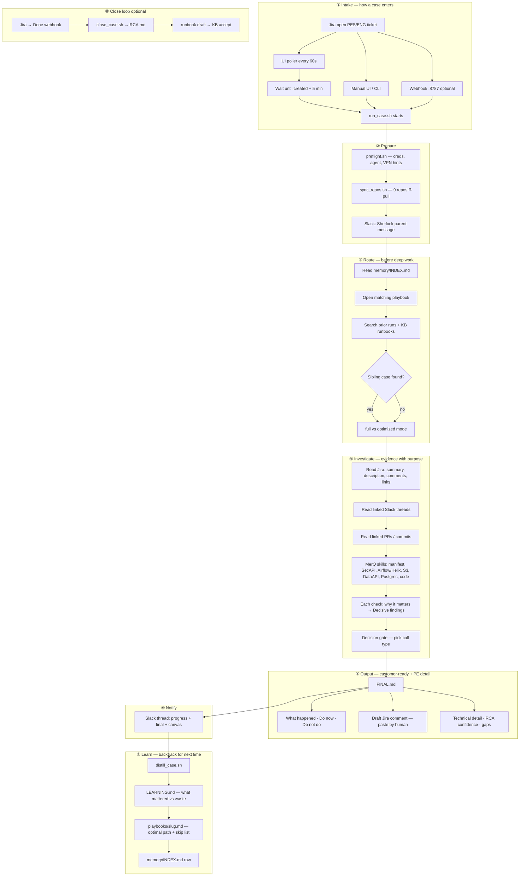
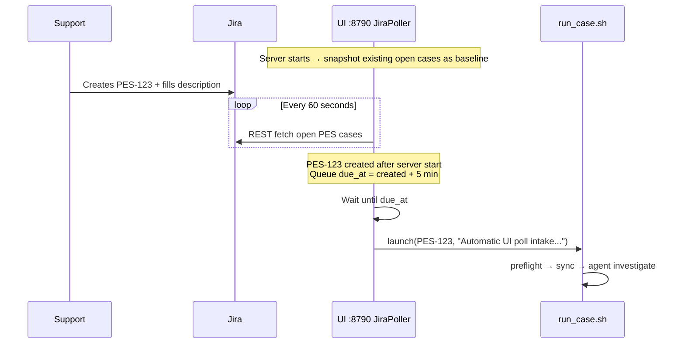
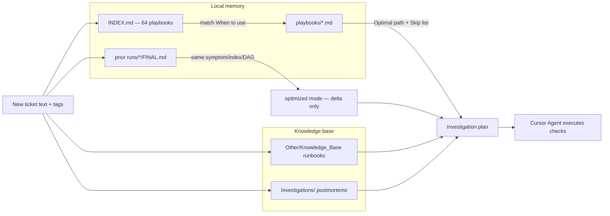
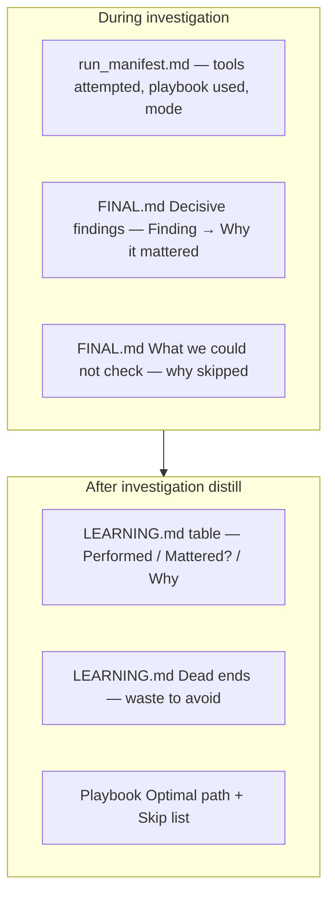
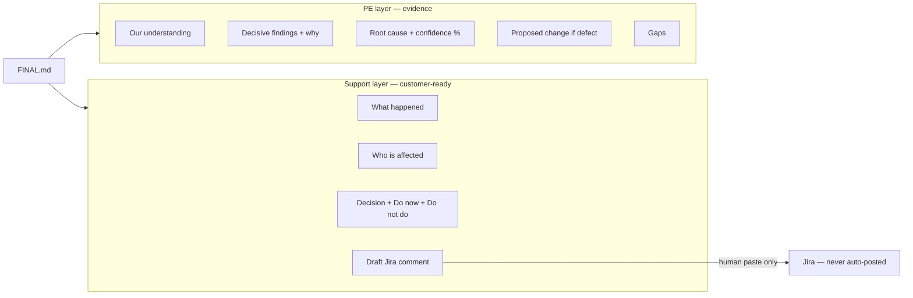

# Sherlock — Architecture Map

**How Case Analysis is actually configured** (verified from `ui/backend.py`, `run_case.sh`, `prompts/investigate.md`, `prompts/distill.md`)

**Visual map (open in browser):** [`sherlock-how-it-runs-map.html`](sherlock-how-it-runs-map.html)

---

## Your mental model vs configured reality

| You remembered | Configured as |
|----------------|---------------|
| Polls every X minutes | Polls every **60 seconds** by default (`CASE_ANALYSIS_AUTO_POLL_SECONDS=60`) |
| Waits 5 min for support to fill Jira | **5-minute delay after ticket creation** before auto-start (`CASE_ANALYSIS_AUTO_DELAY_SECONDS=300`) — gives support time to add description/comments |
| Check similar cases, runbooks, playbooks | **Playbook-first** → prior `FINAL.md` / sibling cases → `Knowledge_Base` runbooks |
| Skills for Airflow, S3, DB, SecAPI, manifest, code | Yes — via Cursor Merq skills + `codebase/skill_scripts/` (see evidence catalog below) |
| Customer-ready draft | `FINAL.md` → **Draft Jira comment** section (human pastes; never auto-posted) |
| Backtrack what we used + why each check | **During run:** `Decisive findings` (finding → why it mattered) + `run_manifest.md` (tools attempted). **After run:** `distill_case.sh` → `LEARNING.md` + playbook **Optimal path** / **Skip list** |

**Also configured (easy to forget):**

- **Session baseline:** UI poller only auto-starts tickets **created after the UI server started** — existing open PES cases are ignored.
- **Preflight + repo sync** before every investigation (9 git repos).
- **Slack (Sherlock):** parent message at start, threaded progress, final summary + canvas on completion.
- **Decision gate:** six call types (false alarm, ops fix, inventory, enhancement, blocked, real defect) before writing support-facing sections.
- **Optimized mode:** if a strong prior sibling case exists, reuse its path and only investigate deltas.
- **Close loop:** Jira Done webhook → `close_case.sh` → `RCA.md` + optional runbook draft to KB.
- **Webhook intake (alt):** `:8787` push from Jira Automation — code ready, not daily ops yet.

---

## End-to-end flow (simple)



---

## Intake detail (Jira poller)



**Env knobs:**

```bash
CASE_ANALYSIS_AUTO_POLL_SECONDS=60    # poll interval (not minutes)
CASE_ANALYSIS_AUTO_DELAY_SECONDS=300  # grace period after create
CASE_ANALYSIS_AUTO_POLL=0             # disable poller
```

---

## Investigation routing (playbook → prior → full path)



**Playbook example structure** (`memory/playbooks/*.md`):

- **When to use** — symptom routing
- **Optimal path** — ordered checks (the backtracked “fast path”)
- **Skip list** — checks that wasted time before
- **Likely RCA patterns** — what usually causes this
- **Source cases** — PES keys that taught this playbook

---

## Evidence sources (skills & tools)

What the agent is configured to use (`prompts/investigate.md` evidence catalog):

| Source | What it answers | How |
|--------|-----------------|-----|
| **Jira** | Ticket context, links | REST / Atlassian MCP read-only |
| **Slack threads** | Context never in Jira | Slack read MCP |
| **GitHub / PRs** | Recent changes | Links from ticket + LeanKG |
| **Index manifest** | Index config, job enabled, namespace | `get_manifest.py` / IndexAPI skill |
| **DissAPI / Admin UI** | Report wiring, SFTP targets | Skills + targeted reads |
| **SecAPI** | Posted levels, metrics, futures roots | `get_index_secapi_metrics.py`, raw history skills |
| **Airflow (Merq)** | DAG runs, task logs | Merq Airflow REST skills |
| **Helix MWAA** | Platform Helix DAGs | CloudWatch via `helix-prod` profile |
| **DataAPI / S3** | Ingestion jobs, vendor files, backups | Ingestion dump, S3 list (artifacts/) |
| **Postgres (DB1)** | Focused validation | Read-only MCP queries |
| **Codebase** | Ownership, regression | LeanKG + 9 synced repos |
| **Knowledge_Base** | Runbooks, prior investigations | Local markdown search |

**Rule:** use what applies; anything skipped must appear in **What we could not check** with reason.

---

## “Why we check this” — where it lives

Sherlock does **not** randomly scan everything. Purpose is recorded at three layers:



This is the **backtracking loop**: next similar case starts from playbook optimal path instead of rediscovering.

---

## Output shape (FINAL.md)



---

## Parallel paths not in the main loop

| Path | Trigger | Output |
|------|---------|--------|
| **Open-PES digest** | Manual / scheduled (prototype) | Pre-call Slack summary |
| **Blind evaluation** | `CASE_ANALYSIS_MODE=blind` | Audit isolation — no memory, no Slack, no distill |
| **Machine pack** | `pack_machine.sh` | Portable zip for another host |
| **Recurring runbook** | `close_case.sh` on Done + ≥3 similar | Draft in `memory/runbook_drafts/` → human `accept_runbook.sh` → KB |

---

## Ports & processes

| Port / process | Role |
|----------------|------|
| **8790** | Web UI + optional Jira poller thread |
| **8787** | Jira webhook receiver (create → investigate, Done → close) |
| **run_case.sh** | One-shot investigation pipeline (not a daemon) |
| **distill_case.sh** | Post-run learning agent |
| **slack_notify.py** | Sherlock bot posts |

---

## Guardrails (always on)

- Remote systems: **read-only**
- Jira: **draft comment only** — support pastes
- No prod writes, no git commit/push, no DAG triggers
- Agent writes only under `runs/<KEY>_<ts>/` (+ memory on distill)
- Gaps disclosed honestly in FINAL

---

## Quick reference — one paragraph

Sherlock watches Jira (poll every **60s** or webhook push), waits **5 minutes** after a new ticket so support can fill details, then runs `run_case.sh`: preflight, sync repos, and a Cursor Agent that **routes playbook-first**, checks prior cases and KB runbooks, gathers evidence from MerQube skills (manifest, SecAPI, Airflow/Helix, S3, DataAPI, Postgres, code), records **why each finding mattered**, classifies the case, and writes a **customer-ready FINAL** with a paste-ready Jira draft. Slack shows live progress. After completion, **distill** backtracks the useful path into a playbook so the next similar investigation is faster — and skips checks that previously wasted time.
