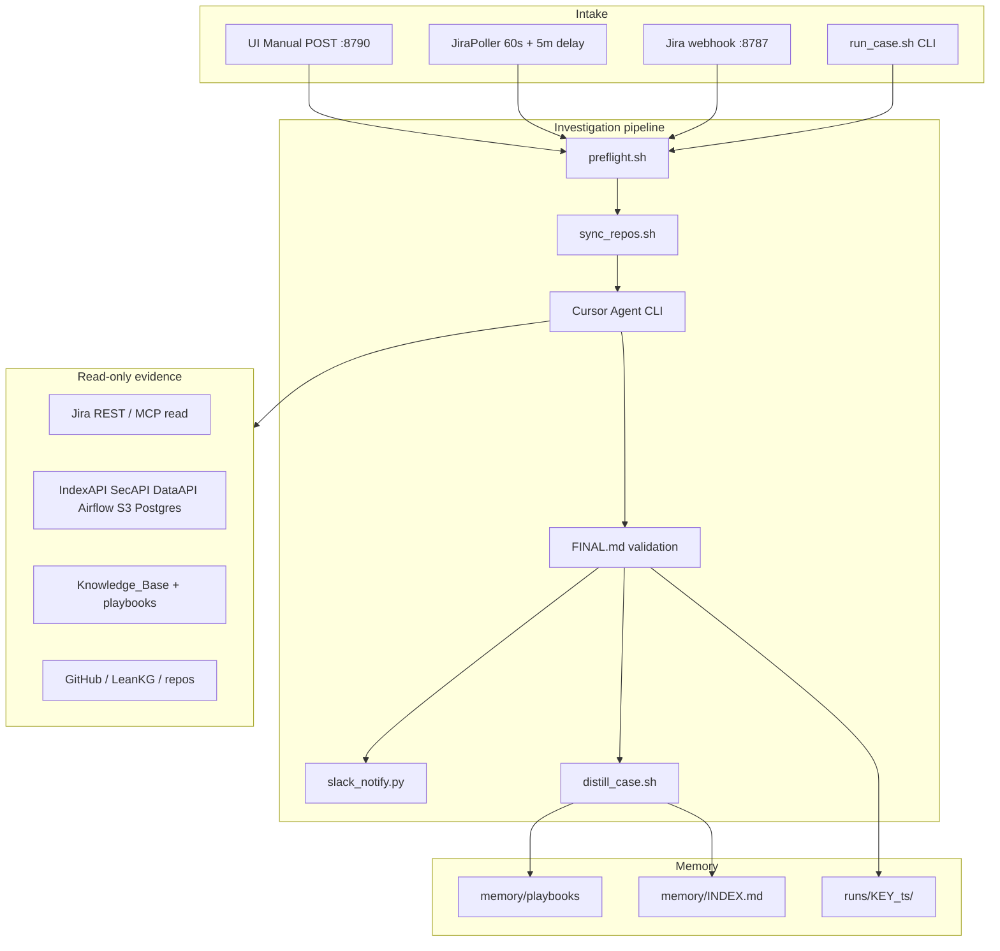

# Sherlock — Technical Dossier (Management Appendix)

**Status:** Working prototype  
**Canonical path:** `/Users/arjit/Dev/case_analysis` (same inode as `Case_Analysis` on macOS)  
**Primary transcript:** [Sherlock creation & build](004f760d-dfff-43d7-ac6e-b814be597429)  
**Last verified:** 2026-09-17 from local code + artifacts

---

## 1. What Sherlock is (naming)

| Name | Meaning | Verified? |
|------|---------|-----------|
| **Sherlock** | Product/codename for PE automated investigation + Slack bot identity | User-assigned; not a code symbol |
| **Case Analysis** | Official UI/README name | Yes — `ui/static/index.html`, `README.md` |
| **Jarvis** | Older README label for the same Slack bot | Legacy prose only |
| **HolmesGPT** | Separate experiment under `AI_ENGINEER/` (port 8792) | **Not Sherlock** |

**One-line:** Sherlock is an automated Platform Engineering Support investigator that runs on a developer machine or dedicated host, produces evidence-backed reports, posts progress to Slack, and learns reusable playbooks over time.

---

## 2. Problem and design intent

### Pain (from `PROPOSAL.md`, `PES-optimization.md`)

1. **Before the PES call** — engineers re-read Jira, Slack, and half-finished actions to align on what is open.
2. **On a new case** — the same evidence hunt repeats: Jira context, KB, IndexAPI/DissAPI/SecAPI, Airflow/Helix, S3, code, prior tickets.

### Three complementary loops

```text
A. Open-PES digest     → "What should we talk about?" (broad, shallow)
B. Case investigation  → "What is wrong and what do we do?" (deep, evidence-backed)
C. Learning / playbooks → "Next similar case is cheaper."
```

Sherlock (the full system) implements **B + C**; digest is **A** via `open_pes_digest.py`.

---

## 3. Architecture map (detailed)

**Full walkthrough with intake timing, routing, evidence catalog, “why we check this” layers, and learning loop:**

→ [`sherlock-architecture-map.md`](sherlock-architecture-map.md)

**Quick correction on polling:** the UI poller runs every **60 seconds** (not minutes). The **5-minute** value is a **post-create grace period** so support can fill Jira before auto-investigation starts.

---

## 4. Architecture (component view)



### Key ports and processes

| Port | Service | Role |
|------|---------|------|
| **8790** | `run_ui.sh` → `ui/server.py` | Local console; optional Jira poller thread |
| **8787** | `webhook_server.py` | Jira create/Done → `run_case.sh` / `close_case.sh` |
| — | `run_case.sh` | Core orchestrator (no daemon) |

### Agent runtime

- **CLI:** `agent -p --trust --force --approve-mcps --workspace /Users/arjit/Dev --sandbox disabled`
- **Model:** `CASE_ANALYSIS_MODEL=auto` (cost-routed)
- **Auth:** `CURSOR_API_KEY` or `agent login`
- **Prompts:** `prompts/investigate.md`, `distill.md`, `close.md`, `blind_evaluation_contract.md`

---

## 5. End-to-end run lifecycle

1. **Intake** — Manual UI, CLI, UI poller (new cases only after server start + 5 min delay), or webhook.
2. **Preflight** — `~/.merq_creds`, AWS STS, agent CLI, optional internal ping (non-strict by default).
3. **Repo sync** — `git pull --ff-only` on 9 repos in `config/repos.txt`; record SHAs in run folder.
4. **Investigate** — Playbook-first; read Jira + linked Slack/PRs; gather MerQube evidence; write `FINAL.md`.
5. **Slack (Sherlock bot)** — Parent message at start + final thread reply and canvas (if configured).
6. **Distill** — `LEARNING.md` + create/update playbook + `memory/INDEX.md` row.
7. **Close loop (optional)** — Done webhook or `close_case.sh` → `RCA.md`; runbook draft if recurring.

### Per-run artifacts (`runs/<KEY>_<timestamp>/`)

| File | Purpose |
|------|---------|
| `FINAL.md` | Structured report (required sections) |
| `run_manifest.md` | Status, timestamps, playbook used, distill result |
| `agent_stdout.log` | Cursor agent output |
| `artifacts/` | Evidence dumps (S3 lists, JSON, logs) |
| `LEARNING.md` | Post-distill learning |
| `slack_progress.json` | Slack thread metadata |

---

## 6. Capabilities matrix

| Capability | Status | Evidence |
|------------|--------|----------|
| Unattended PES/ENG investigation | **Current** | `run_case.sh`, `prompts/investigate.md` |
| Playbook-first + distill learning | **Current** | 64 playbooks, `memory/INDEX.md` |
| Optimized mode (reuse prior RCA) | **Current** | `investigate.md` + prior `FINAL.md` |
| Local web console | **Current** | `:8790`, Manual/Automatic/Capabilities/History |
| Slack progress + canvas | **Current** | `slack_notify.py`, `slack_canvas.py` |
| Open PES digest | **Prototype** | `open_pes_digest.py` |
| Jira UI poller | **Current** | `JiraPoller`, 60s interval, 5m delay, session baseline |
| Jira webhook auto-intake | **Code only** | `webhook_server.py`, `EC2.md`, systemd unit |
| Close-loop RCA | **Current** | `close_case.sh` |
| Recurring runbook → KB | **Prototype** | 2 drafts; `accept_runbook.sh --accept` |
| Blind evaluation harness | **Current** | `run_blind_evaluation.py`, `audit_blind_run.py` |
| Machine pack for onboarding | **Current** | `pack_machine.sh`, shared Slack token in pack |
| VPN/SSO human gate (Stage 0) | **Roadmap** | Discussed, deferred |
| Vector recall / Postgres store | **Roadmap** | UI Capabilities "planned" pills |
| Auto-post to Jira | **Explicit non-goal** | All prompts + README |

---

## 7. Measured footprint (local artifacts, 2026-09-17)

Source: `capability_metrics()` in `ui/backend.py` over `case_analysis/runs/` and `memory/`.

| Metric | Value | Interpretation |
|--------|-------|----------------|
| Investigation run folders | **161** | Includes retries and blind eval runs |
| Unique case keys | **118** | Distinct PES/ENG keys touched |
| Reports (`FINAL.md`) | **114** | Completed structured outputs |
| RCA reports | **0** | Close-loop not widely exercised yet |
| Playbooks | **64** | Durable optimal-path guides |
| Runbook drafts | **2** | Pending human accept to KB |
| Repositories in scope | **9** | `config/repos.txt` |

**Do not claim:** these numbers prove RCA accuracy or customer impact — they measure **activity and learning surface area**.

---

## 8. Blind evaluation (quality control)

**Purpose:** Measure whether the agent can investigate **without** seeing comments, prior runs, or playbooks (sanitized ticket only).

| Batch | Cases | Audit pass | Notes |
|-------|-------|------------|-------|
| `20260916T171030Z` | 27 | 23 pass, **4 audit_failed** | Leakage / forbidden path references |
| `20260916T200359Z` (rerun subset) | 4 | **4 pass** | After hardening blind contract |

**What audit validates:** isolation controls (`prior_sherlock_memory_accessed: no`, no direct target Jira fetch, no memory reads).  
**What audit does NOT validate:** whether `FINAL.md` RCA matches human ground truth — **resolution scoring is roadmap work**.

---

## 9. Jira intake — verified decision (not WebSocket)

Searched **461** agent transcripts. **No Jira WebSocket design** was discussed.

| Mechanism | When to use | Implemented | Typical deployment |
|-----------|-------------|-------------|-------------------|
| **Jira Automation → HTTP webhook** | Always-on host (EC2) | Yes (`webhook_server.py:8787`) | **Not operationalized** in daily use |
| **REST poller (UI thread)** | Laptop while console runs | Yes (`JiraPoller`) | Poll **every 60s**; **5 min** delay after create; session baseline |
| **Manual CLI / UI** | Ad hoc, demos | Yes | Primary daily path |

**Clarification:** "5 minutes" = **wait after ticket creation** before auto-start, not "poll every 5 minutes."

**Open risk:** Running UI poller and webhook concurrently without coordination may double-trigger investigations (flock per issue on webhook; poller tracks active jobs — not fully unified).

Adjacent: Slack **socket_mode** was searched when user asked to "run Sherlock" — **not built**; Sherlock Slack is outbound-only via bot token.

---

## 10. Integrations and guardrails

### Read-only contract (investigation)

- No Jira comments/transitions, no prod writes, no git commit/push, no DAG triggers.
- Agent may write only under `runs/<KEY>_<ts>/` and (on distill) `memory/`.
- Jira draft in `FINAL.md` is **paste-ready for humans**, not auto-posted.

### Auth / secrets

| Secret | Purpose |
|--------|---------|
| `CURSOR_API_KEY` | Unattended agent |
| `JIRA_*` | Poller, digest, blind ticket fetch |
| `CASE_ANALYSIS_SLACK_BOT_TOKEN` | Sherlock posts (shared in machine pack) |
| `~/.merq_creds` | IndexAPI/SecAPI/DataAPI |
| AWS SSO | S3, Airflow, Helix logs |
| `CASE_ANALYSIS_WEBHOOK_SECRET` | Webhook header |

---

## 11. Example outcomes (safe to cite)

| Case | Outcome | Confidence | Playbook |
|------|---------|------------|----------|
| PES-1061 | Admin UI SFTP link mismatch | ~90% | `adminui-report-sftp-link-mismatch` |
| PES-1155 | Reuters DSP settlement restatement | 96% | `secapi-reuters-dsp-settlement-correction` |
| PES-1069 | YCharts report migration | Documented in runs | `ycharts-report-migration-index-reports-miss` |

Excerpt pattern: synthesized understanding → decisive findings table → gaps → RCA + confidence → paste-ready Jira draft.

---

## 12. Claim status matrix (for presenters)

| Claim | Say it? | Label |
|-------|---------|-------|
| Automated first-pass PES investigation with structured output | Yes | **Current** |
| 64 learned playbooks shorten repeat failure classes | Yes | **Current** |
| Slack Sherlock posts live progress and final summary | Yes | **Current** |
| Never auto-posts to Jira or mutates prod | Yes | **Current** |
| 161 runs / 118 cases / 114 reports | Yes | **Current** (activity metrics) |
| Blind eval proves RCA accuracy | **No** | Say: proves **audit/isolation** only |
| Sherlock runs 24/7 as a daemon | **No** | Investigations are processes; UI poller is session-scoped |
| Jira webhook in production today | **No** | **Code ready**; ops not turned on |
| WebSocket / Atlassian streaming | **No** | **Never built**; use webhook vs REST poll story |
| Vector DB / unified Postgres memory | **No** | **Roadmap** (UI labels "planned") |
| HolmesGPT is Sherlock | **No** | Separate experiment |

---

## 13. Roadmap (from `PROPOSAL.md` + UI)

1. Harden output quality (synthesis, decisive-only Slack, Jira drafts) — in progress  
2. Widen evidence catalog (Slack/PR links, Helix vs Merq routing)  
3. Operationalize pre-call digest on a schedule  
4. Optional auto-intake via webhook for High/TRIAGE  
5. Portable team kit (pack exists; full clone onboarding documented)  
6. Stage 0 VPN/SSO gate before deep runs  
7. Blind eval **resolution scoring** (human-labeled ground truth)  
8. Vector recall by symptom (planned in UI)  
9. Central case store / Postgres (planned in UI)  

---

## 14. Key file reference

| Area | Path |
|------|------|
| Orchestrator | `scripts/run_case.sh` |
| UI | `scripts/run_ui.sh`, `ui/server.py`, `ui/backend.py` |
| Webhook | `scripts/webhook_server.py` |
| Slack | `scripts/slack_notify.py`, `scripts/slack_canvas.py` |
| Memory | `memory/INDEX.md`, `memory/playbooks/` |
| Prompts | `prompts/investigate.md`, `distill.md`, `close.md` |
| Ops | `EC2.md`, `deploy/case-analysis-webhook.service` |
| Pack | `pack/README.md`, `scripts/pack_machine.sh` |
| Proposal | `PROPOSAL.md`, `PES-optimization.md` |

---

## 15. What is not Sherlock

| System | Path |
|--------|------|
| HolmesGPT | `/Users/arjit/Dev/AI_ENGINEER/` |
| Scheduled batch triage | `/Users/arjit/Dev/scheduled_analysis/` |
| PES case dashboard | `/Users/arjit/Dev/Dev_Projects/pes-case-dashboard/` |
